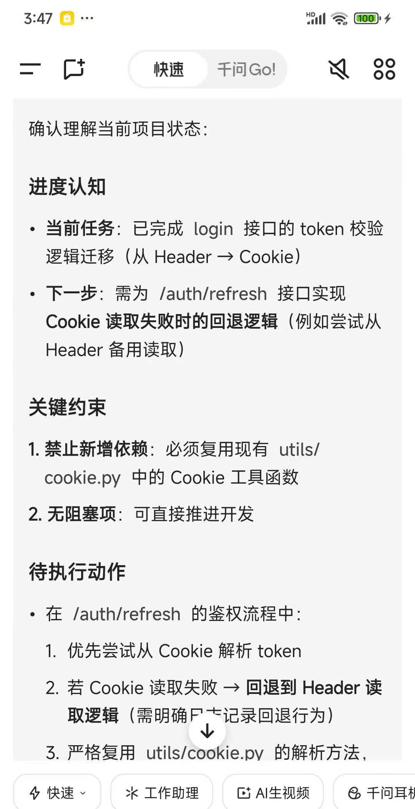
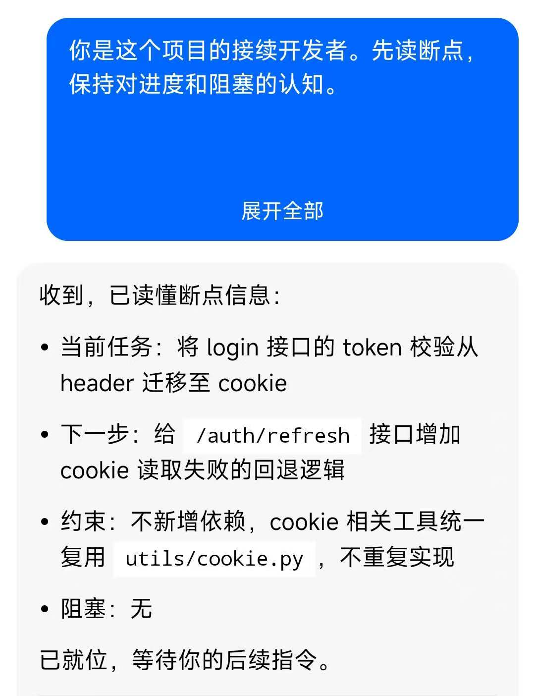
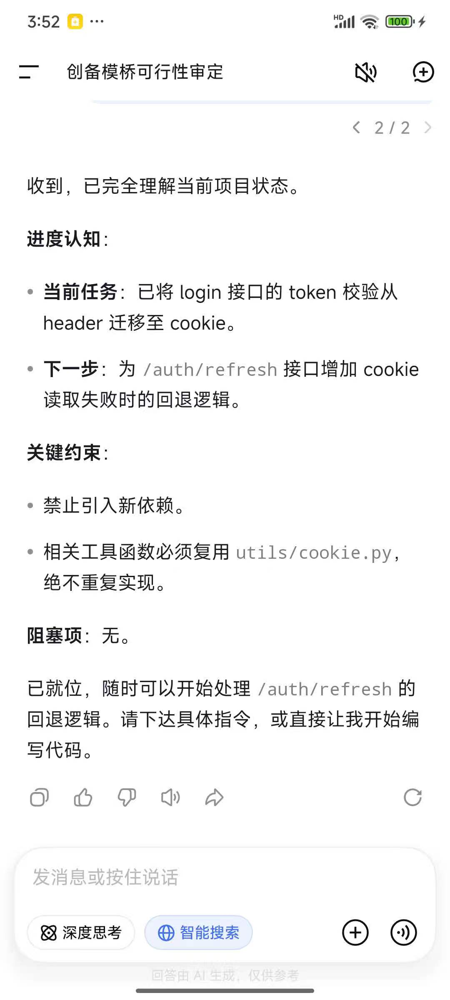

\# ModelAnchor（创备模桥）


\*\*一个模型无关的通配档案层。当前版本实现断点字段的跨模型携带；档案格式从第一天起就按"可容纳任意项目上下文层"设计，扩展路径已定义、接缝已预留，按需求阈值逐层激活。\*\*


Slogan：创有先备，模桥通配。


\## 它解决什么


换会话、换模型时，新模型不知道你上次做到哪、下一步做什么、被什么卡住。


\## 当前版本（v0.1）实现什么


\- 一个 `断点.md` 模板，四个固定字段：当前、下一步、阻塞、交接备注

\- 一个 `pack.py` 打包器，把断点编译成接续 prompt，粘贴到任意模型即可接续

\- 仅 Python 标准库，零外部依赖，本地运行，不托管任何数据


\## 与 AGENTS.md / CLAUDE.md 的关系


基线、规约、决策留在项目原有的指令文件里（低频修改）；\*\*只有断点由本工具管理\*\*（高频变化、跨模型切换最需要携带）。本工具是这些指令文件的上游断点层，不是替代品。


\## 快速上手


```bash

python packer/pack.py --init                 # 生成 断点.md 模板

\# 编辑 断点.md，填写当前/下一步/阻塞

python packer/pack.py --minimal              # 输出接续 prompt，粘贴到任意模型


## 效果展示

**跨模型无缝接续实测：**

- 千问（Qwen）：
  
- 豆包（Doubao）：
  
- DeepSeek：
  


不做什么（v0.1 明确边界）

不做 WebUI、不做云端、不做 API 自动调用、不做 MCP 服务器。这些是已定义的扩展模块，按需求阈值激活，不是永久排除。扩展接缝见 docs/05-路线图.md。


